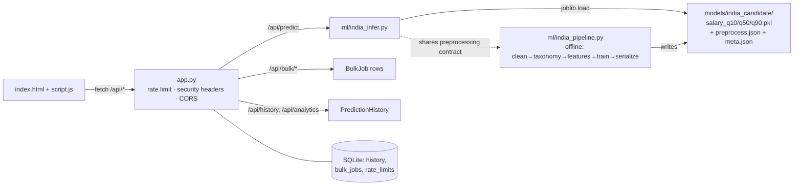

# Employee Salary Prediction System — Complete Technical Reference

Everything in this document was extracted from the repository source code, configuration files, datasets, model artifacts and test files. File paths and function names are real.

---

## 1. Project introduction

A Flask + SQLite web application that produces **annual-India-market salary benchmarks** for job roles, plus bulk HR salary-planning tools. It is a capstone AIML project: a real-data-trained quantile regression model served behind a REST API and a vanilla-JS frontend, deployed on Vercel.

## 2. Problem statement & objectives

HR teams lack a fast, data-grounded way to answer *"what should this role realistically pay in the Indian market, and what would an increment cost?"* The app addresses this with (a) individual salary benchmarks, (b) bulk estimation over employee sheets, and (c) transparent increment-scenario arithmetic. Intended users: HR teams / students demonstrating an end-to-end ML product.

## 3. Technology stack

| Layer | Tech | Where used |
|---|---|---|
| Language | Python 3.14 | everything |
| Backend | Flask 3.1.3, Flask-SQLAlchemy 3.1.1, Flask-CORS 6.0.1 | `app.py` |
| ML | scikit-learn 1.8.0 (HistGradientBoosting quantile regressors), joblib 1.6.0 | `ml/india_pipeline.py`, `ml/india_infer.py`, `models/*.pkl` |
| Data | pandas 3.1.1, NumPy 2.5.5 | `app.py` (uploads), `ml/*` |
| DB | SQLite via SQLAlchemy | `history.db`, models in `app.py` |
| Spreadsheets | openpyxl 3.1.5 (XLSX in/out) | `app.py` `_read_upload`, `_export_xlsx` |
| Frontend | Jinja2 template + vanilla JS (548 lines), TailwindCSS CDN, Chart.js, Inter font | `templates/index.html`, `static/script.js` |
| Tests | pytest 9.2.0 (`requirements-dev.txt`) | `tests/` — **50 tests, all passing** |
| Deploy | `vercel.json`, serverless Flask | live at employeesalaryprediction-delta.vercel.app |

**Unused dependency check:** `shap` was removed from requirements after the legacy path was deleted — nothing references it now. All remaining deps are used.

## 4. Architecture



Two deliberately separate ML paths: **`india_pipeline.py` = offline training** (run manually, writes artifacts + `ml_results/` reports); **`india_infer.py` = production inference** (loads persisted artifacts, never retrains).

## 5. Repository structure

```
app.py                        861 lines — Flask app factory, ~15 routes, DB models, rate limiter
templates/index.html          Single-page app shell: sidebar nav + 5 tab sections, inline CSS
static/script.js              All client logic: nav, predict, bulk wizard, history, charts
static/salary_banner.jpg      Unused asset (no  reference)
ml/india_pipeline.py          384 lines — offline training pipeline
ml/india_infer.py             155 lines — production inference
models/registry.json          Active version = india-salary → models/india_candidate
models/india_candidate/       3 quantile .pkl + preprocess.json + meta.json
data/raw/                     2 real datasets
data/processed/               clean / rejected / taxonomy CSVs
ml_results/                   4 JSON evaluation/provenance reports
tests/                        7 files, 50 tests
vercel.json, requirements*.txt, .env.example, README.md, history.db(gitignored runtime)
```

**Active vs supporting:** everything above is active except `salary_banner.jpg` (unused asset). There are **no legacy files** — the IBM/synthetic/legacy-model code and data were removed in commit `8488c94`.

## 6. Datasets

| File | Rows | Cols | Role |
|---|---|---|---|
| `data/raw/india_salary_benchmarks_2026_sample.csv` | 12,959 | 15 | **Training source** — Fliar job-posting salary observations, annual INR |
| `data/raw/labour_bureau_wages.csv` | 67 | 6 | **Reference only** — Govt of India Labour Bureau sector avg *daily* wages; explicitly never mixed into salary targets |
| `data/processed/india_salary_clean.csv` | 11,172 | 20 | Cleaned training data (+ `_src_row`, `reject_reason`, normalized cols) |
| `data/processed/india_salary_rejected.csv` | 1,786 | 20 | Rejected rows with reasons (lineage preserved) |
| `data/processed/job_taxonomy.csv` | 8,562 | 10 | canonical_title → aliases, job_family, dept, seniority, observations, cities, median_salary, supported flag |

Raw columns: `posting_id, posted_month, company, company_domain, job_title, role_family, seniority, experience_band, city, industry_category, salary_min_inr, salary_max_inr, salary_mid_inr, fliar_profile_url`. **Target = `salary_mid_inr`** (annual INR). **No synthetic data remains** in the project.

## 7. Data preprocessing (`india_pipeline.py`)

- `load_india()` / `load_labour()` — ingestion
- `clean_india(df)` — drops rows missing title/salary/city; enforces salary plausibility bounds; rejects duplicates; emits `reject_reason` per row; produces normalized text columns (`_norm_text`, `_title_case`)
- `build_taxonomy(clean)` — collapses ~free-text titles into canonical titles via alias matching → `job_taxonomy.csv`; marks `supported` only when `observations ≥ MIN_TITLE_SUPPORT` (**≥5**)
- Split: **80/20 random, seed 42** → n_train=8,937, n_test=2,235 (`india_model_comparison.json`)
- Leakage prevention: grouping by family for subgroup eval; fingerprints (`dataset_fingerprint`, `taxonomy_fingerprint` sha256) stored in `preprocess.json` so inference verifies it runs against the same data contract

## 8. Feature engineering (`engineer_features`, pipeline → `meta.json`/`preprocess.json`)

| Model feature | Source | Transform | Why |
|---|---|---|---|
| `job_family` | `role_family`/taxonomy | categorical bucket | strongest salary signal |
| `seniority` | `seniority` col | categorical (9 levels) | pay band driver |
| `exp_mid_years` | `experience_band` | band→midpoint numeric | experience proxy |
| `city_bucket` | `city` | top-40 cities else "Other" | geography pay gap |
| `industry_bucket` | `industry_category` | top-15 industries else "Other" | sector pay gap |
| `posted_year` | `posted_month` | year numeric | market drift |

Categorical encoding: one-hot/ordinal handled inside HistGradientBoosting's native categorical support; `preprocess.json` persists `top_cities`(40), `top_industries`(15), `exp_band_map`(6), `seniority_levels`(9) so **training and inference share identical bucketing**.

## 9. ML algorithms & artifacts

Three **quantile regressors** — `HistGradientBoostingRegressor` at quantiles 0.1/0.5/0.9 (chosen over Ridge/median baselines by CV in `evaluate_models`):

| Artifact | Quantile | Meaning |
|---|---|---|
| `salary_q10.pkl` | 0.1 | ~10% of market salaries fall below |
| `salary_q50.pkl` | 0.5 | median — shown as headline estimate |
| `salary_q90.pkl` | 0.9 | ~10% fall above |

P10 ≤ P50 ≤ P90 is **enforced by clamping** after inference. `meta.json` records algorithm="GradientBoosting", features, quantiles, dataset, caveats.

## 10. Training process (`run_all`, `india_pipeline.py:330`)

ingest → `clean_india` → `build_taxonomy` → `engineer_features` → `evaluate_models` (Ridge, GBM variants, median baselines; 5-fold CV + holdout) → `train_range_models` (fits q10/q50/q90, `joblib.dump`) → writes `meta.json`, `preprocess.json`, `dataset_quality.json`, `source_provenance.json`, `india_model_comparison.json`, `interval_validation.json`.

## 11. Model evaluation (real numbers, held-out 20% test, n=2,235)

From `meta.json` / `india_model_comparison.json` / `interval_validation.json`:

| Metric | Value | Meaning |
|---|---|---|
| MAE | ₹418,877 | mean abs error on test |
| RMSE | ₹715,632 | penalizes large misses |
| R² | 0.5219 | ~52% variance explained |
| MedAE | ₹208,264 | typical error |
| Interval coverage | **80.3%** empirical (target 80%) | p10–p90 band honesty |
| Interval width | ~₹20.1L empirical | wide — high market variance |

Subgroup coverage varies: sales 76.5%, HR 74%, customer-service 84.1%. Baselines (median_global MAE ₹636,763, median_family ₹611,936) were beaten by GBM (CV MAE ~₹544k class). **Honest read:** R²≈0.52 and ~₹4.2L MAE mean estimates are rough benchmarks, not precise offers — which is why the UI labels them "benchmarks."

## 12. Backend (`app.py`, 861 lines)

| Endpoint | Method | Purpose |
|---|---|---|
| `/` | GET | serves `index.html` |
| `/api/predict` | POST | single prediction → P10/P50/P90 + provenance; persists to history unless `simulate` |
| `/api/model` | GET | registry, categories, algorithm, metrics, caveats |
| `/api/analytics/summary` | GET | dashboard stats |
| `/api/history` | GET/DELETE | list (paginated) / clear |
| `/api/history/<id>` | DELETE | delete one record |
| `/api/bulk/template` | GET | CSV/XLSX template w/ column guide |
| `/api/bulk/validate` | POST | parse+validate upload, no predictions |
| `/api/bulk/process` | POST | validate→predict all→persist `BulkJob` |
| `/api/bulk/jobs` | GET | list jobs |
| `/api/bulk/jobs/<id>` | GET | job detail (results/errors) |
| `/api/bulk/jobs/<id>/scenario` | POST | increment scenario arithmetic |
| `/api/bulk/jobs/<id>/export` | GET | XLSX/CSV export |
| `/api/health` | GET | db_ok + models_loaded |

DB tables: `history` (name, salary, risk_score, kind, timestamp), `bulk_jobs` (filename, model_version, row counts, results/errors/summary JSON), `rate_limits` (fixed-window counters).

## 13. Database design

Flask-SQLAlchemy models `PredictionHistory` and `BulkJob`; `rate_limits` table backs the DB-backed fixed-window limiter (`rate_allow`). `_migrate_history_table()` adds columns on startup. DB URI: `ESPS_DB_PATH` → `./history.db`, or `/tmp/history.db` on Vercel.

## 14. Frontend modules

- **Dashboard** — welcome/actions card, 5 stat cards (from `/api/analytics/summary`), department bar chart (Chart.js), recent bulk jobs
- **Individual Prediction** — India-fields form (name, experience, job title*, city, seniority, industry) → `/api/predict` → result card with annual salary, p10–p90 range line, canonical title/family/support/observations, benchmark disclaimer
- **Bulk Salary Planning** — 5-step wizard (stepper UI): template download → dropzone upload (`/api/bulk/validate`) → results table (paginated) → scenario form (increment %, dept overrides, budget, cap → `/scenario`) → export (`/export`)
- **Prediction History** — bulk jobs table + individual predictions table, search, pagination, delete, clear-all
- **Model Overview** — active model card, dataset card, features, workflow, limitations, coverage counts, metrics grid — all populated from `/api/model`

## 15. Individual prediction workflow

Form → `POST /api/predict` → rate limit → `load_all()` (lazy `india_infer._load()`) → `_predict_india` → `india_infer.predict_salary` → `resolve_title` (alias→canonical, rejects <5-obs titles) → feature bucketing via `preprocess.json` → 3 quantile models → clamp P10≤P50≤P90 → `PredictionHistory` insert → JSON `{salary_annual_inr, salary_p10_inr, salary_p90_inr, canonical_title, job_family, support_level, market_observations, range_note, disclaimer}` → JS renders.

## 16. Bulk workflow

Upload CSV/XLSX (≤5MB, ≤5000 rows, formula-injection-safe parsing) → `/api/bulk/validate` → `/api/bulk/process` runs `predict_salary` per row → `BulkJob` persisted with full results/errors/summary JSON → scenario = **pure arithmetic** (increment % on *current* salaries, optional dept overrides/budget/cap; annual↔monthly conversion — recently fixed 12× bug) → export XLSX (4 sheets) or CSV.

## 17. Security implemented

Rate limiting (global `/api/*` + per-endpoint predict/bulk limits, DB-backed), security headers (CSP, X-Frame-Options DENY, nosniff, Referrer-Policy, Permissions-Policy), CORS allowlist, file-type/size validation, CSV/XLSX formula-injection escaping (`_safe_cell`), proxy-header trust gated behind `ESPS_TRUST_PROXY=1`, input validation on all payloads. **Missing/unverified:** no auth (intentional demo), no HTTPS enforcement in app, no CSRF (JSON APIs, low risk), Vercel `/tmp` DB is ephemeral.

## 18. Limitations

- R²≈0.52, MAE ~₹4.2L — benchmarks only, wide p10–p90 (~₹20L)
- Titles with <5 observations rejected; ~171 supported titles
- Sample is Fliar postings — coverage skews to listed metros/industries
- No auth; per-IP rate limit only; ephemeral DB on Vercel
- Tailwind via CDN (not production-optimized); `history.db` exists in old git history (names only — needs history rewrite to purge, not done)
- Scenario math is arithmetic, not ML — by design

## 19. End-to-end workflow

Raw CSV → `clean_india` (reject reasons) → `build_taxonomy` (canonical titles, ≥5 obs) → `engineer_features` (6 features) → `evaluate_models` (CV + holdout, pick GBM) → `train_range_models` (q10/q50/q90) → serialize `.pkl`+JSON → `india_infer` loads at runtime → Flask API → JS UI → SQLite history.

## 20. Interview prep — likely questions

- **Why quantile regression?** Salary has huge variance; a single point estimate hides it. P10/P50/P90 gives an honest market range. Pinball-loss quantile GBMs beat median baselines (MAE ₹544k CV vs ₹612k family-median).
- **Why HistGradientBoosting?** Handles nonlinearity + native categorical support, fast, no scaling needed (that's why no scaler .pkl).
- **Train/serve skew prevention?** `preprocess.json` persists buckets + sha256 fingerprints; inference uses identical mapping.
- **Why reject rare titles?** <5 observations → unreliable estimates; honest rejection beats guessing.
- **Is p10–p90 a confidence interval?** No — it's a predictive quantile range; ~80% empirical coverage verified on holdout.
- **Increment scenario ML?** No — deliberately transparent arithmetic so HR can audit the math.
